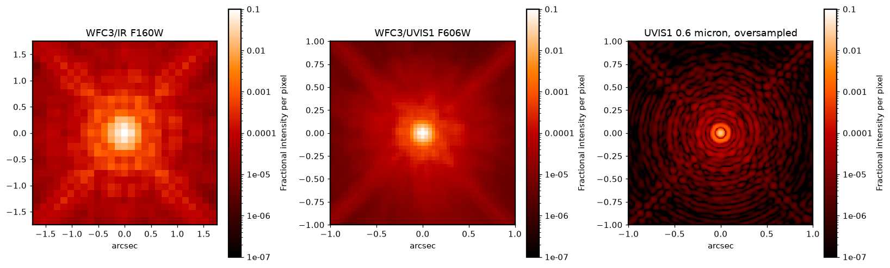
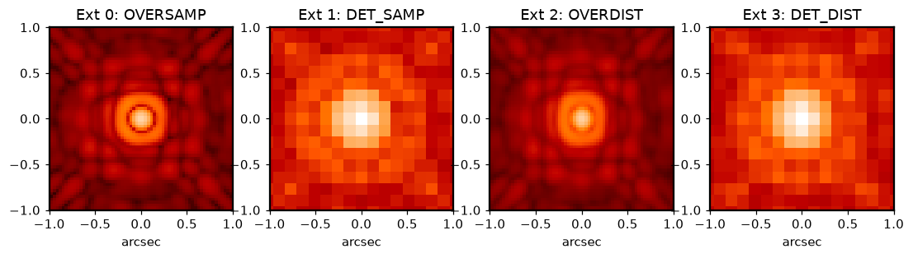

*******************************
Hubble Instrument Model Details
*******************************

The :py:mod:`stpsf.hst` module enables simulations of the Hubble Space Telescope's
:ref:`Wide Field Camera 3 (WFC3) <hst_wfc3>`, including both its IR and UVIS channels.
Other HST instruments may be added in the future.

.. warning::

   The HST models are new, and are a work in progress. The first phase of this work re-implements the optical
   model of the `Tiny Tim <https://www.stsci.edu/hst/instrumentation/focus-and-pointing/focus/tiny-tim-hst-psf-modeling>`_
   PSF simulator on top of STPSF and poppy, with the goal of *reproducing* Tiny Tim's results, not yet improving on
   them. Where Tiny Tim makes questionable choices, the model follows it by default, and notes the difference.
   See :doc:`hst_validation_vs_tinytim` for the comparisons and the known remaining differences.

.. _hst_wfc3:

Wide Field Camera 3 (WFC3)
==========================

   Example polychromatic PSFs with detector effects for the WFC3 IR channel (F160W) and the UVIS channel (F606W), and
   a monochromatic, oversampled UVIS PSF, at the default position on each detector. Log-scaled intensity.

To work with WFC3, instantiate it like any of the JWST instruments::

    >>> import stpsf
    >>> wfc3 = stpsf.WFC3()
    >>> wfc3.filter = 'F160W'
    >>> psf = wfc3.calc_psf(fov_pixels=61, oversample=4)

Usage is, for the most part, the same as for any other STPSF instrument model. For help with setting attributes like
filters and sampling, refer to `Using STPSF <usage.html>`_.

The optical model
-----------------

The model is made up of a sequence of optical planes, all evaluated in the same coordinate frame:

#. The analytic pupil of the Hubble OTA (a 2.4 m annulus with a central obscuration, four spiders, and three mirror
   support pads), with exact fractional coverage of the pixels along its edges;
#. The primary and secondary mirror wavefront error maps (from Tiny Tim); the secondary map shifts with the position in
   the field, as the beam footprint moves across the mirror;
#. The instrument aberrations, Zernike terms Z4 to Z8 (focus, astigmatism and coma) that are polynomial functions of
   position on the detector, plus an optional focus term for a despace of the secondary mirror;
#. For the IR channel only, the WFC3/IR cold pupil mask.

Channels, detectors and filters
-------------------------------

WFC3 has an IR channel and a UVIS channel, which has two detectors, UVIS1 and UVIS2. These detector names are available as
``wfc3.detector_list``. Setting a filter automatically switches to the channel that contains it, keeping the current
UVIS detector if the new filter is also a UVIS one. For reference the filters of each channel are listed in
``wfc3.ir_filter_list`` and ``wfc3.uvis_filter_list``. ::

    >>> wfc3.filter = 'F606W'
    >>> wfc3.detector
    'UVIS1'
    >>> wfc3.detector = 'UVIS2'
    >>> wfc3.filter = 'F814W'   # stays on UVIS2
    >>> wfc3.filter = 'F160W'   # switches back to the IR channel
    >>> wfc3.detector
    'IR'

The channel itself cannot be set directly.

Field dependence
----------------

The PSF depends on position on the detector, through the instrument aberrations and the position of the beam on the
secondary mirror. A newly instantiated model is at the center of the detector. To change the position, assign an
(X, Y) tuple of **0-based** pixel coordinates (as in Tiny Tim)::

    >>> wfc3.detector = 'UVIS1'
    >>> wfc3.detector_position
    (2072, 1025)
    >>> wfc3.detector_position = (4000, 1950)

Changing the detector resets the position to the center of the new detector. The IR detector is 1014 by 1014 pixels,
and positions on the UVIS detectors run from 0 to 4095 in X and 0 to 2047 in Y.

Sampling and the pixel scale
----------------------------

By default, the pixel scale used in the optical calculation is the mean scale of the detector's SIAF
aperture (0.128 arcsec for IR, 0.0395 arcsec for UVIS).  Tiny Tim's nominal scales of 0.13 and 0.04
arcsec are slightly different from the current SIAF values.  To use those, create the model with
``stpsf.WFC3(use_tinytim_pixelscale=True)``. A pixel scale that you set yourself is kept when you
change the detector.  The WFC3 pixels are not square on the sky. In STPSF this is handled as a geometric distortion step
(outputs in extensions OVERDIST and DET_DIST, same as for JWST PSFs); this distortion is analogous
to that applied by Tiny Tim in its ``tiny3`` stage.

Both channels undersample the PSF, particularly the UVIS channel at short wavelengths. As for other STPSF models,
measurements of PSF properties like FWHM or encircled energy should be made on oversampled data, such as the
``OVERSAMP`` extension.

Detector effects
----------------

The output FITS file contains the usual ``OVERSAMP`` and ``DET_SAMP`` extensions, followed by ``OVERDIST`` and
``DET_DIST``, which add detector effects to the oversampled and detector-sampled PSF:

* For both channels, the geometric distortion of the SIAF is applied, resampling the PSF onto the actual detector pixel grid with non-square pixels.
* On the IR channel, Tiny Tim's inter-pixel capacitance kernel (3 by 3 pixels) is applied.
* On the UVIS channel, a charge diffusion kernel (also 3 by 3 pixels) is applied, which depends on wavelength and on
  position as in Tiny Tim.

   The four extensions of a WFC3/IR F160W PSF: the oversampled PSF, the PSF binned to detector pixels, and
   each of those after applying distortion and the detector effects. The images were made with::

       fig, axes = plt.subplots(figsize=(12, 3), ncols=4)
       for ext in range(len(psf)):
           stpsf.display_psf(psf, ext=ext, ax=axes[ext], title=f'Ext {ext}: {psf[ext].header["EXTNAME"]}',
                             imagecrop=2, colorbar=False)

Each of these distinct effects can be turned off with the ``options`` dictionary::

    >>> wfc3.options['add_distortion'] = False
    >>> wfc3.options['add_ipc'] = False                # IR only
    >>> wfc3.options['add_charge_diffusion'] = False   # UVIS only

Spectra and wavelengths
-----------------------

As with other instruments, a polychromatic PSF is calculated from a spectrum, which defaults to a 5700 K blackbody,
using ``nlambda`` equal-width wavelength bins across the filter. To use the wavelengths and weights that Tiny Tim
would use (the points at which the filter throughput is tabulated, weighted by throughput, source spectrum and
wavelength spacing), set ``wfc3.tinytim_wavelengths = True``. Filters that are tabulated at a single wavelength (such
as the narrow-band filters) are monochromatic. ::

    >>> wfc3.filter = 'F160W'
    >>> wfc3.tinytim_wavelengths = True
    >>> psf = wfc3.calc_psf(source=my_spectrum, fov_pixels=61, oversample=4)   # a synphot SourceSpectrum

Instrument aberrations and focus
--------------------------------

The field-dependent instrument aberrations are included by default, and can be turned off with
``wfc3.include_si_wfe = False``. The focus of the telescope changes over time, from the breathing of the OTA and
changes of the secondary mirror position, and Tiny Tim models it with a despace of the secondary mirror. Set
``wfc3.despace_microns`` to a value to include the corresponding focus term. ::

    >>> wfc3.despace_microns = 5.0

.. note::

   Tiny Tim has a quirk, which the model reproduces by default: with no despace, the field-dependent *focus* term of the
   instrument aberrations (about 9 nm RMS across the detector) is silently dropped, while the field-dependent
   astigmatism and coma are kept. With a nonzero despace, the field-dependent focus is applied. Set
   ``wfc3.tinytim_skip_zero_terms = False`` to always include it. See :doc:`hst_validation_vs_tinytim`.
