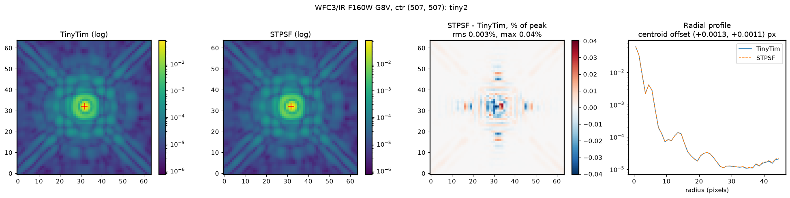
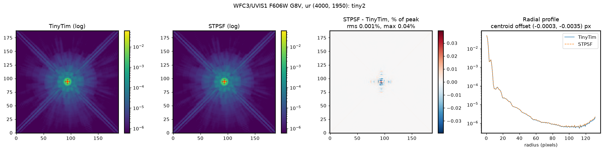
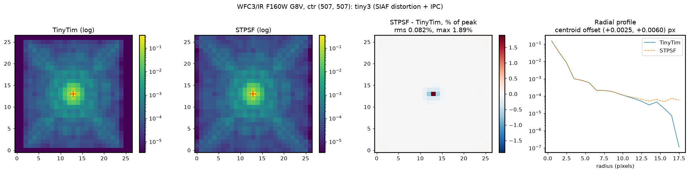
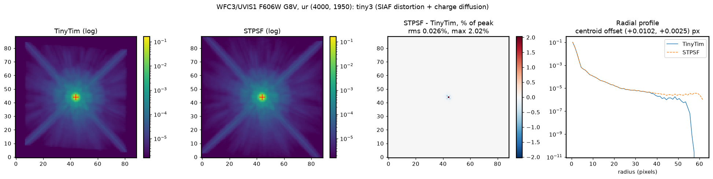

*******************************************
Hubble Models: Validation Against Tiny Tim
*******************************************

The first phase of the :doc:`HST models <hst>` aims to reproduce the output of
`Tiny Tim <https://www.stsci.edu/hst/instrumentation/focus-and-pointing/focus/tiny-tim-hst-psf-modeling>`_, so the
models have been compared with Tiny Tim's own output in some detail. This page summarizes the comparisons, and the
small differences that remain. For WFC3, the PSFs agree with Tiny Tim's undistorted output to within about 0.1% of the
peak pixel, and to a few percent of the peak after distortion.

The implementation in STPSF is intentionally not a direct line-for-line port of the algorithms in Tiny Tim; rather it is a 
reimplementation within the existing framework of STPSF and POPPY. As such, small differences are expected, due in particular
to some known different choices in algorithms and approaches between the two codes. 

How the comparisons are made
============================

The comparisons use PSFs made with Tiny Tim itself (``tiny2``, which gives the undistorted PSF, and ``tiny3``, which
adds geometric distortion and detector effects) for a set of reference cases covering both WFC3 channels, several positions
on each detector, and monochromatic and filter-integrated (G8V star) PSFs. They are run by the regression
tests in ``dev_utils/run_hst_regression_tests.py``, which need a Tiny Tim installation and so are not part of the
automated test suite. The tests that need no Tiny Tim files are in ``stpsf/tests/test_hst.py``.

A few details are worth keeping in mind for this comparison:

* Tiny Tim's PSF is integrated over detector pixels, so STPSF should use an oversampling of at least 8
  (``detector_oversample`` in Tiny Tim's terms).
* Tiny Tim centers its PSF on a pixel, so an odd ``fov_pixels`` must be used in the STPSF calculations.
* Tiny Tim normalizes its PSF to the flux in the field it writes, whereas STPSF retains the flux that falls outside it
  (about 15% at 3 arcsec). Normalize both to the sum of the field before comparing.
* For a more exact comparison, STPSF should use Tiny Tim's wavelengths and weights (``tinytim_wavelengths = True``) and 
  its exact pixel scale for ``tiny2`` (set ``pixelscale`` to the "Integrated PSF scaling" value in the ``tiny1`` ``.par`` file).  ``tiny3`` output is on the SIAF pixel scale. The SIAF pixel scales are not those of Tiny Tim's nominal 0.13 and 0.04
  arcsec, as the pixels are not square on the sky.

Wavefront and pupil
===================

The wavefront error and pupil were compared with the maps that Tiny Tim itself writes out (its pupil, and its wavefront
including the mirror maps, the field-dependent aberrations and the secondary mirror shift). At the four positions
checked (two IR and two UVIS), the wavefront differs by less than 0.05 nm RMS after removing piston, from a total of
about 35 nm RMS at the center of the IR detector, and by at most 0.3 nm anywhere. The open area of the pupil agrees to
within 0.15%. The field-dependent Zernike terms for focus, astigmatism and coma, evaluated for all 32 reference
cases, agree with those recorded by Tiny Tim to 1e-4 waves.

PSFs without distortion (``tiny2``)
===================================

The undistorted PSFs agree very closely. Differences between STPSF and Tiny Tim are given as a fraction of Tiny Tim's
peak pixel value.

.. list-table::
   :header-rows: 1

   * - Case
     - Maximum difference
     - RMS difference
   * - IR, 1.6 micron, monochromatic
     - 0.04%
     - 0.006%
   * - IR, F105W / F160W, G8V
     - 0.13%
     - 0.003%
   * - UVIS, 0.6 micron, monochromatic
     - 0.06%
     - 0.003%
   * - UVIS, F275W / F438W / F606W / F814W, G8V
     - 0.13%
     - 0.002%

Centroids agree to about 0.003 pixel.

   STPSF and Tiny Tim for a WFC3/IR F160W PSF of a G8V star, at the center of the detector. The panels show the Tiny Tim
   and STPSF PSFs (log scale), their difference in percent of the peak, and the radial profiles, which are
   indistinguishable at this scale.

   As above, for WFC3/UVIS1 F606W at position (4000, 1950).

PSFs with distortion and detector effects (``tiny3``)
=====================================================

After distortion, and the inter-pixel capacitance (IR) or charge diffusion (UVIS) kernels, the agreement is less close,
by up to about 3% of the peak (RMS of 0.01% to 0.12% of the peak). These differences are concentrated in the core of the
PSF, which is undersampled, and at the edges of the image. Centroids agree to about 0.01 pixel.

   STPSF and Tiny Tim for the distorted WFC3/IR F160W PSF, including inter-pixel capacitance.

   STPSF and Tiny Tim for the distorted WFC3/UVIS1 F606W PSF, including charge diffusion. The dark edges of the Tiny Tim
   image, and the sharp drop in its radial profile, are an artifact of its distortion mapping.

Sources of the remaining differences
====================================

**The pupil.** Tiny Tim draws its pupil with 8 by 8 subsampling and then rotates it with bilinear interpolation, which
softens the edges and gives it an open area about 0.09% larger than the exact geometry that STPSF uses. This is the
identified origin of the remaining differences in the undistorted PSFs: STPSF has 0.05% to 0.13% less flux in the PSF
core (within 0.3 arcsec) and about 0.03% more in the wings. Using Tiny Tim's own pupil in an emulation of its
calculation removes the difference. In the STPSF implementation we intentionally do not reproduce the softened edge 
from Tiny Tim's bilinear interpolation, because the exact geometry is closer to
the true shape of the pupil. The numerical agreement is also helped by a partial cancellation with differences in how the PSF is
resampled onto pixels, so it should not be expected to improve with finer oversampling beyond 8.

**Distortion.** Tiny Tim and SIAF use different geometric distortion models, and their resampling of an undersampled
PSF differs. In particular the Tiny Tim algorithm is subject to an obvious artifact of a band of dark pixels around the outside of the image. 
This accounts for the differences in the ``tiny3`` comparisons, including the edge artifacts of Tiny Tim
mentioned above.

**Field positions.** The position of a detector pixel in the telescope's V2, V3 frame differs between Tiny Tim and the
SIAF, by up to about an arcsecond. STPSF uses the current SIAF as implemented in PySIAF, which uses updated values relative to the legacy values
used in Tiny Tim. The effect on the PSF is small.

Tiny Tim behaviors that are reproduced
======================================

Some Tiny Tim behaviors that may be unintended are reproduced by default, so that the results match. All of these are
described in the documentation of the :py:mod:`stpsf.hst` module.

* The field-dependent focus is dropped when there is no despace (``tinytim_skip_zero_terms``; see :doc:`hst`).
* The wavelength spacing of the weights uses the full spacing, not half, at the two ends of the filter's throughput
  table, and wavelengths carrying less than 1% of the peak weight are skipped.
* The annular Zernike terms use the same central obscuration (0.33) for the IR cold mask, whose obscuration is 0.354.
* For UVIS charge diffusion, all wavelengths above 0.4 micron use the pair of kernels tabulated at 0.6 and 0.8 micron,
  so shorter wavelengths are extrapolated.

Reproducing the comparisons
===========================

With a Tiny Tim installation and the STPSF data, the reference PSFs can be made and the tests run with::

    export TINYTIM=/path/to/tinytim
    export TINYTIM_REF=/tmp/tinytim_ref
    dev_utils/hst_make_tinytim_reference_psfs.sh -S -o $TINYTIM_REF
    pytest dev_utils/run_hst_regression_tests.py -p no:warnings

Each test that compares PSFs takes ``plot=True``, which makes figures like those above, e.g. from a notebook::

    import sys
    sys.path.insert(0, 'dev_utils')
    import run_hst_regression_tests as regression
    regression.test_wfc3_ir_monochromatic_vs_tinytim(507, 507, 'ctr', plot=True)

